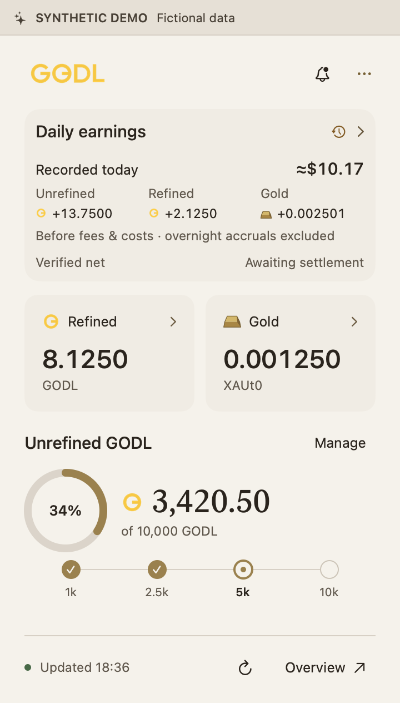
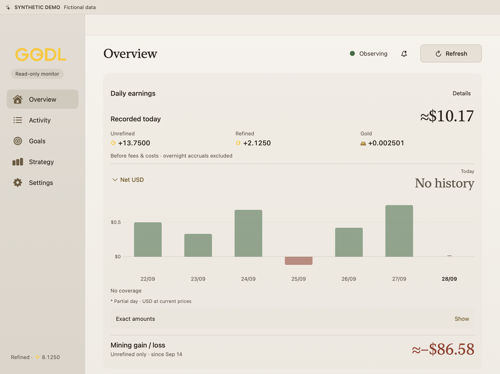
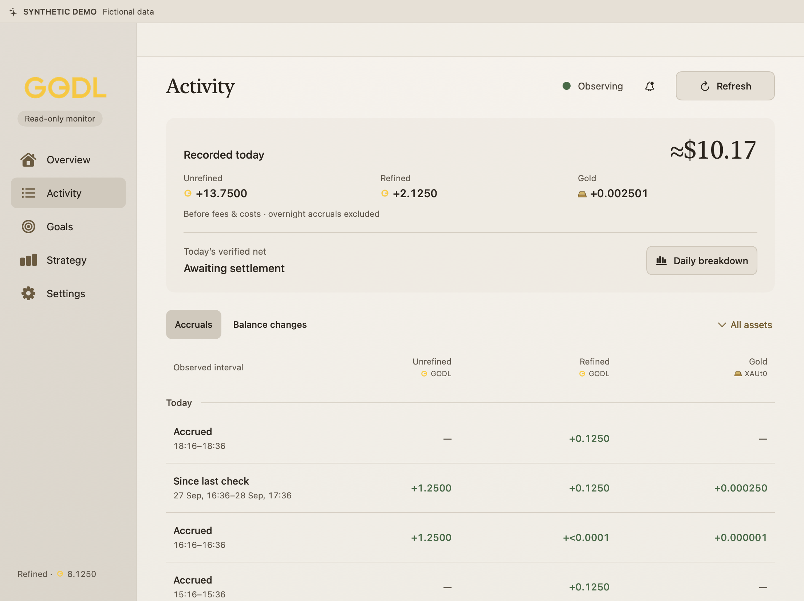
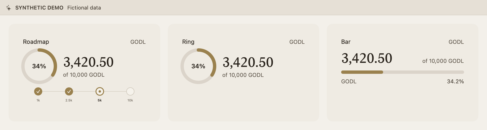

<p align="center">
  
</p>

<p align="center">
  Your GODL rewards, balances and goals. One native Mac app.
</p>

<p align="center">
  Native macOS · Read-only · Build from source · MIT source
</p>

> [!IMPORTANT]
> **Source-build alpha.** Build and install your own copy using the steps below. No Apple Developer membership or signing certificate is needed. Builds are locally ad-hoc signed, not Developer ID signed or Apple notarized; there is no official binary download. See [tested platforms and limits](docs/releasing.md#candidate-validation).

<p align="center">
  
</p>
<p align="center"><sub>Native preview from 28 September 2026, before the 0.2.17 earnings-card simplification. All pictured financial data is fictional. See image provenance below.</sub></p>

GODL Monitor observes a public Solana address. It never connects to your wallet,
signs transactions, claims rewards or controls mining. Close the window and the
menu-bar monitor keeps running.

## Build and install

You need a Mac, full Xcode with Swift 6 and its command-line tools selected,
Python 3.12+, and Node.js **26.7.0** with npm. The tested build toolchain is
Xcode 27.0 / Swift 6.4 on Apple silicon. See [development setup](docs/development.md)
for tool checks, contributor workflows and a smaller Apple-silicon-only build.
The source is public; cloning does not require a GitHub account.

```sh
git clone https://github.com/ivnv00/godl-monitor.git
cd godl-monitor
npm ci --ignore-scripts --prefix engine
python3 scripts/check.py
NODE_ARM64="$(python3 scripts/fetch-node-runtime.py --arch arm64)"
NODE_INTEL="$(python3 scripts/fetch-node-runtime.py --arch x64)"
python3 scripts/build-local-app.py --node-runtime "$NODE_ARM64" \
  --intel-node-runtime "$NODE_INTEL" --universal --dmg
```

Open `dist/GODL-Monitor-0.2.40-universal.dmg`, drag **GODL Monitor** into
**Applications**, then eject the image. Open the app, enter a **public Solana
address**, and choose **Start monitoring**. Follow the [setup guide](docs/getting-started.md)
for macOS security prompts, updates, optional RPC setup and troubleshooting.

Packaging uses the clean committed checkout, downloads verified runtimes and
installs locked dependencies. Commit your reviewed changes before rebuilding;
downloaded source ZIPs without Git history are not supported by the builder.
The finished app includes Node and its dependencies, so those build tools are
not needed to run it. Nothing is uploaded or installed automatically.

The app targets macOS 14+ and can build Apple silicon and Intel executable slices.
Packaged-app use on Intel, macOS 14 and clean-Mac installation remain unverified. Treat
this as an alpha, keep private backups before updates, and see the
[known limits](docs/roadmap.md). Apple Developer signing and notarization are
not planned for this source-sharing path.

## What you can see



- **Balances:** unrefined GODL, refined GODL and gold, with current USD estimates.
- **Daily rewards:** recovered mining credits and refined/gold yield when a
  verified midnight opening exists. Observed journal intervals remain separately
  dated and partial; missing coverage stays unknown. All are before fees and costs.
- **Verified net:** a separate figure when reward and cost history supports it;
  browse older covered weeks, with clear pending and unavailable states.
- **Claim breakdown:** exact principal, refined rewards, deductions and receipts
  for isolated supported claims whose saved evidence proves every component.
  Missing evidence stays unknown; claiming earlier holdings is not new income.
- **Goals:** five metrics, three visual styles, and your choice of widget pins.
- **Activity and alerts:** meaningful accruals and balance movements, plus a
  persistent notification inbox for catching up.
- **Move Macs:** privately [back up and restore goals and recorded rewards](docs/profile-transfer.md), with no existing-profile replacement.
- **CSV export:** take matching recorded accruals into Numbers or Excel, with
  exact token amounts and observation intervals. [Export guide](docs/activity-export.md).



Balances refresh about every 15 seconds while the app and Mac are awake. Quitting
or sleep pauses monitoring; waking the Mac requests fresh data automatically.
Catch-up intervals are observations, not a fabricated
transaction-by-transaction or complete-day history.

<details>
<summary>Goal styles and first-run setup</summary>



Create several goals and choose a style for each. A single pinned goal stays
fixed; multiple pinned goals share a bounded scrolling area in the widget.

<p align="center"></p>

</details>

## Your address stays out of the download

The generic app contains no user's wallet address, RPC key or history. A new Mac
starts with its own setup and local data. Public Solana RPC is the default; an
optional personal endpoint can help with shared rate limits. Follow the
[Helius setup tutorial](docs/getting-started.md#optional-helius-or-another-rpc-provider)
to use your own key. There is no automatic cloud sync or history transfer.
See [privacy and local data](docs/privacy.md).

Net cost, daily net and cumulative gain/loss require a separately reviewed,
wallet-specific accounting anchor, imported through **Settings → Set up accounting**.
The app checks file consistency; preparing and reviewing the historical basis
remains an expert task. It never creates a zero-cost baseline.
Recorded rewards and current gross holding values work without that anchor.
Cumulative gain/loss is deliberately limited to verified unrefined GODL, not
whole-wallet profit, and remains unavailable across claims without a complete
historical basis. Read [accounting and coverage](docs/accounting.md).

## Documentation

For contributors: [Architecture](docs/architecture.md) · [Changelog](CHANGELOG.md) · [Roadmap](docs/roadmap.md).

[Current status](docs/current-status.md) is the installed-version and verification
record; the [roadmap](docs/roadmap.md) is the remaining-work tracker. Dated review
reports, plans and screenshots describe their named milestones, not the latest
app. Their older test totals and superseded limitations are historical evidence.
Artifact-retention statements in those dated records also describe their named
milestone. The [17 October closeout](docs/plans/session-closeout-20261017.md) records
the current stopped app, single installation and consolidated private recovery
custody after obsolete builds and installers were removed.

| Start here | Understand the numbers | Contribute |
| --- | --- | --- |
| [Install and set up](docs/getting-started.md) | [Accounting and coverage](docs/accounting.md) | [Development](docs/development.md) |
| [Privacy and local data](docs/privacy.md) | [Missing values and recorded rewards](docs/earnings-availability.md) | [Contributing](CONTRIBUTING.md) |
| [Release status](docs/releasing.md) | [Activity behavior](docs/activity-review.md) | [Security policy](SECURITY.md) |

Source code is [MIT licensed](LICENSE). Artwork has a separate rights boundary;
see [NOTICE](NOTICE) and [image provenance](docs/images/README.md).
GODL Monitor is an unofficial community project, not affiliated with or endorsed
by GODL Supply.
