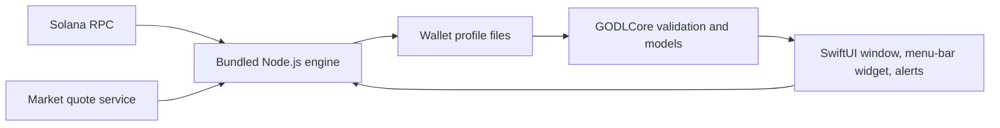

# Architecture

GODL Monitor is a read-only macOS application. A native SwiftUI shell owns the
user experience and local lifecycle; a bundled Node.js engine reads public chain
state and produces validated files for the native model layer. Neither side has
wallet signing, claiming, swapping, or mining-control capability.

The arrow from the UI to the engine represents launching read-only observation
and reconciliation subprocesses. The engine writes local results; Swift does not
parse provider responses directly.

## Native application

`Sources/GODLMonitor/` contains the app scene, AppKit window and menu-bar
lifecycle, SwiftUI views, notification delivery, and `MonitorController`.
`MonitorController` starts the bundled engine, accepts only output for the active
wallet, retains the last valid observation on refresh failure, and schedules
observation and optional accounting refreshes.

`Sources/GODLCore/` is independent of the views. It decodes and validates the
engine's monitor document, preserves unknown values, models goals and earnings,
and owns the reward inbox and its detection cursor. Exact decimal strings and
integer base units cross this boundary; presentation code formats them without
recomputing accounting results.

## Observation and accounting engine

`engine/monitor-cli.mjs` is the observation entry point. It reads finalized
public chain state, appends validated snapshots to SQLite, loads current quotes,
and writes `monitor-view.json` atomically. `engine/monitor.mjs` projects balances
and reward state, while `engine/earnings.mjs` derives only the earnings values
supported by available evidence.

Accounting is a separate path. `engine/accounting-cli.mjs` extends a reviewed
wallet-specific anchor with finalized transaction and market evidence. Without
that anchor, balances, reward observations, goals, current quotes, and gross
holding values continue to work; cost and net figures remain unavailable. See
[Accounting and coverage](accounting.md) for the exact limits.

## Local profile boundary

The application-support root stores the selected public-wallet setting and the
optional RPC configuration. Each new wallet receives an isolated `Wallets/`
profile containing its observations, projected view, goals, reward inbox, quote
cache, and any explicitly supplied accounting files. A legacy wallet may keep
its existing root profile during upgrade; the app does not copy that history
into another profile.

Unreadable or unsupported settings, goals, and inbox files are preserved and
the affected writes stop. Projected engine JSON uses atomic replacement; observation history lives in
SQLite. Settings, goals and inbox writes use owner-only temporary files and
atomic replacement. Profile data is runtime state: it
must never enter source control or distributable packages. See [Privacy and
local data](privacy.md).

## Separate meanings

- **Observations** are finalized public-chain snapshots and balance changes.
  They are evidence, not cash-flow classification.
- **Recorded accruals and the reward inbox** are increases detected between
  observations. Their timestamps bound detection intervals and can contain
  catch-up gaps; they are gross amounts before fees and costs.
- **Accounting** reconciles reviewed historical evidence into covered cost and
  net results. It never infers a zero-cost opening balance or fills missing
  coverage with zero.
- **Quotes** are independently cached current market data. Fresh quotes can
  value current holdings and recorded accruals even when accounting is absent.

## Packaging boundary

The package targets macOS 14 and builds `GODLCore` plus the `GODLMonitor`
executable. The local packager embeds checksum-verified Node runtimes and the
JavaScript engine, combines Apple silicon and Intel slices for a universal app,
and creates scanned ZIP and DMG candidates. This packaging architecture does
not imply Developer ID signing, notarization, native Intel execution, or clean
Mac validation. Those gates remain in [Releasing](releasing.md).

## Runtime failure boundary

The observation and accounting CLIs emit a single-line failure envelope on stderr:
`schemaVersion: 1`, `kind: godl-runtime-failure`, an allowlisted `code`, and fixed
CLI copy. Swift selects its own recovery text from the code and ignores message
fields, unknown versions/codes and legacy stderr. Optional receipt warnings also
use fixed text. A failure does not replace the last valid observation.

Accounting status adds an optional `failureCode`; old checkpoints remain readable.
The UI never displays the checkpoint’s raw `reason`, including older cached
reasons. Reconciliation preserves the last verified receipt on failure. Raw local
evidence remains private and is not a support report.
