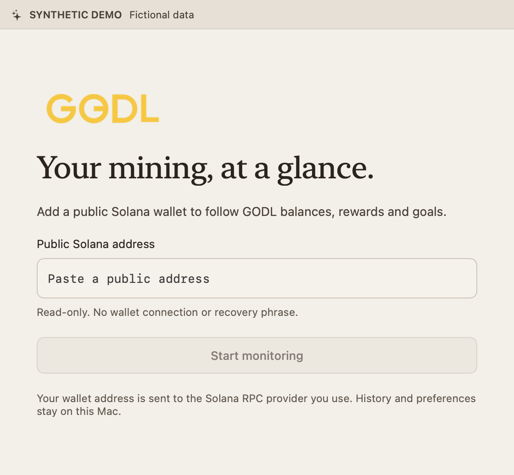

# Install and set up

GODL Monitor is a **source-build alpha**. Build your own copy using the
[README commands](../README.md#build-and-install) and [development setup](development.md).
There is no official binary download and no planned Apple Developer signing or
notarization. The source is public and available to clone or fork.

## What your Mac needs

- A Mac running macOS 14 or later; current packaged-app execution evidence is Apple silicon
- Internet access to a Solana RPC provider and current market quotes
- A public Solana address to observe

Building requires full Xcode, Python and the pinned Node version. Once built,
the app includes its Node runtime and does not require these tools to run.
The universal build includes Apple silicon and Intel slices. Packaged-app use
on Intel, macOS 14 and clean-machine coverage remain unverified; a deployment
target is not a compatibility certification. See [platform evidence](releasing.md#candidate-validation).

## Install your build

1. Open the **GODL Monitor `.dmg`**.
2. Drag **GODL Monitor.app** onto **Applications**.
3. Eject the disk image. Open **GODL Monitor** from Applications.

If you received a ZIP instead, double-click it and move the extracted app to
Applications. Do not launch multiple copies from Downloads and Applications.

Updated copies share a local startup guard. If another copy or its finishing
update still owns the data, the new copy shows **GODL Monitor is already running**
and closes when you dismiss the message. Use the GODL menu-bar icon to reach the
running copy. To switch versions, quit it first, allow any current update to finish,
then open the installed app. Older versions lack this guard: quit them before
upgrading. Do not delete the local lock file to force another copy to start.

Local builds are ad-hoc signed and **not Apple notarized**. If
macOS cannot verify the developer, first confirm the source and build you are
opening. Apple's supported per-app flow is **System Settings →
Privacy & Security → Open Anyway** after trying to open the app. Do not turn off
Gatekeeper, remove quarantine in Terminal, or bypass a malware/damaged-app alert.
If the expected per-app option is unavailable, stop and check your Mac's
management policy; a managed Mac may prohibit exceptions. Do not assume a signed
download will be supplied. See [Apple's opening guidance](https://support.apple.com/102445).

For verification, a `.sha256` sidecar accompanies each ZIP/DMG. Developers can
check the downloaded file with `shasum -a 256 -c <filename>.sha256` from its folder.
A matching checksum checks file integrity; it does not replace signing or trust
in the source of the checksum.

## First run



1. Paste a **public Solana address**.
2. Select **Start monitoring**.
3. Allow macOS notification access if you want reward alerts.
4. If public-RPC refreshes fail or you want your own provider, follow
   [the Helius setup steps below](#optional-helius-or-another-rpc-provider).

Never enter a recovery phrase, private key or signing credential. The app has no
wallet-connect or transaction-signing flow. A valid address with no GODL miner
account is not an app failure; its observed state will reflect that account's
availability.

The main window provides Overview, Activity, Goals, Strategy and Settings. The
GODL menu-bar icon opens the quick overview. Closing a window leaves the app
running; **Quit GODL** stops it. Monitoring pauses while the Mac sleeps.

## Optional launch at login

In **Settings**, turn on **Launch at login** to open GODL Monitor when you sign in
to this Mac. A new installation does not enable this automatically. Keep the app
in Applications so macOS can find the installed copy.

If the setting says **Approval needed**, choose **Open Login Items** and allow
GODL Monitor in macOS System Settings, then return to the app. The setting reads
the macOS preference again; it does not repeatedly request registration after
you deny it. **Cancel registration** removes a pending request.

Turning the switch off prevents future automatic launches and leaves the current
session running. Quitting still stops monitoring until the next launch; launch
at login does not keep a quit app running or monitor while the Mac is asleep.
This preference is local to each Mac and applies to the app, across wallet profiles.

When the Mac wakes, GODL requests a fresh observation and checks configured
accounting history. If an update was already running, a single follow-up waits
for it to finish. Network recovery can take longer; cached values keep their
stale/error status until a successful update. No rewards are invented for the
time the Mac was asleep.

## Read the summary

- **Mining credits today** recovers finalized mining credits from local midnight
  through the displayed time, including offline hours when complete transaction
  evidence is available. Its USD estimate values unrefined principal only.
  Refined/gold yield is a full-day value only when a verified midnight opening
  supports it. Observed intervals and cross-day catch-up retain their separate
  dates and partial coverage; missing coverage stays unknown.
- **Observed today · partial** values the increases saved within today's observation
  intervals, before fees and mining costs. Overnight intervals are not guessed
  into a daily total.
- **Verified net** uses separately reconciled reward and cost history. “Awaiting
  settlement” or “No verified history” is not zero earnings.
- A dash in an accrual row means no increase was recorded for that asset in that
  interval. It is not a zero balance.
- Hover amounts for exact units and current USD estimates. Missing/expired prices
  leave token quantities visible.

New installations can monitor balances, recorded rewards, goals and alerts
without an accounting anchor. They do not automatically inherit the maintainer's
cost basis or history. See [Accounting and coverage](accounting.md).

If you already have a reviewed accounting file for your wallet, use **Settings →
Mining costs → Set up accounting** to inspect and import it. The app shows its
period and recorded costs before you confirm. This is an optional advanced step;
a Helius key does not create or verify an opening cost basis. Follow the
[reviewed-file import steps](accounting.md#import-an-already-reviewed-starting-point).

## Goals

Choose Unrefined GODL, Refined GODL, Gold, Claimable value or Today's net, then
select Roadmap, Ring or Bar. Pin favorites with **Show in widget**. One pinned
goal has a fixed layout; several goals scroll within their shared section.

Claimable value needs complete balances and fresh quotes. Today's net also needs
verified accounting history.

## Optional Helius or another RPC provider

**A Helius key is not required to start.** The app defaults to the public Solana
mainnet RPC. Public endpoints have shared limits and may throttle or block
requests; Solana recommends a provider for production use. For regular monitoring,
using your own provider is recommended. See [Solana's endpoint guidance](https://solana.com/docs/references/clusters).

To use Helius:

1. Create your own account in the [Helius dashboard](https://dashboard.helius.dev/).
   The Free plan is available for trying the app; check its current allowance
   before choosing a plan.
2. Open **API Keys** and copy your **Mainnet HTTPS RPC URL**. Use the standard RPC
   endpoint, not a Devnet, WebSocket, Sender or enhanced API URL. Its format is:

   ```text
   https://mainnet.helius-rpc.com/?api-key=YOUR_HELIUS_API_KEY
   ```

   The example is a placeholder. Use your own dashboard URL; keep the complete
   URL private because it contains your key.
3. In GODL Monitor, open **Settings → Private RPC**, paste the complete URL into
   **HTTPS RPC URL**, and choose **Check & save**. Do not paste only the key. The check verifies
   that the endpoint answers on Solana Mainnet before replacing your saved URL.
   If it fails or you cancel, your previous endpoint stays in place.
4. Choose **Refresh** after a successful save. The connection check confirms
   Mainnet reachability; a successful refresh and new **Updated** time confirm
   that the provider can serve the monitor’s read methods. History access and
   verified net accounting remain separate checks.

The endpoint applies to wallet profiles on this Mac. No maintainer key is
bundled, shared, or needed. Another compatible Solana Mainnet HTTPS RPC provider
also works; it must support the standard read methods the monitor uses.

Check the provider's current plan allowance rather than assuming a free tier
covers every wallet. History reconciliation, retries, other apps and multiple
running Macs also consume credits. Monitor usage in your dashboard.
See [Helius setup](https://www.helius.dev/docs/quickstart) and
[current plans and limits](https://www.helius.dev/docs/billing/plans).

| Symptom | What to check |
| --- | --- |
| Provider unreachable or connection timed out | Internet connection; then try Refresh |
| Mainnet RPC required or check RPC settings | Re-enter your provider’s Mainnet HTTPS URL in Settings |
| RPC access rejected | Key validity, provider access rules and plan status |
| Provider rate limit | Provider usage/limits; allow the next scheduled refresh instead of repeatedly pressing Refresh |
| Balances load but verified net is unavailable | An API key does not supply an opening cost basis or an accounting anchor; see [Accounting and coverage](accounting.md) |

A failed refresh retains the last observation. The error banner links to Settings;
the menu-bar status shows the same failure with recovery guidance on hover.
Accounting failures retain the last verified period instead of inventing new costs.

To return to the public provider, save `https://api.mainnet-beta.solana.com` in
the same field with **Check & save**. A blank field does not remove an existing endpoint. If a key is
exposed, revoke/rotate it in the provider dashboard and save the replacement URL.

The field is obscured and the file has owner-only permissions, but it is not
stored in Keychain or encrypted at rest. Never include it in a bug report. Read
[Privacy and local data](privacy.md).

## Another Mac or another wallet

Installing the app on another Mac starts a new local profile. Enter the same
public address if you want to observe the same wallet. Re-enter any optional RPC
privately. **Nothing is synced or bundled with the app.** To preserve goals and
recorded reward history, use [Save backup and Restore backup](profile-transfer.md)
before adding that wallet on the new Mac. Accounting evidence and observation
charts are excluded; keep the old Mac's private data if you need that history.
Activity's [CSV export](activity-export.md) is for spreadsheet analysis.

To change wallets on one Mac, save the public address in Settings, quit and
reopen. Wallets keep isolated profiles. Unreadable or unsupported settings are
preserved rather than overwritten.

## Update

Build the newer source revision, quit GODL, replace the app in Applications, and
reopen it. App updates leave the separate Application Support data in place.
After replacing the app, check **Launch at login** in Settings if you use it.
Keep a private backup before testing an alpha update. There is no automatic
updater yet.

## Remove the app

Turn off **Launch at login** in Settings, then choose **Quit GODL** from the
menu-bar app and move GODL Monitor from Applications to the Trash. Removing the
app does not delete its local history or credentials. For intentional data
removal, first make any needed private backup, then use Finder to remove the
folder documented in [Privacy and local data](privacy.md#data-kept-on-this-mac).
Deleting that folder removes all profiles and their saved evidence; reinstalling
the app cannot restore it. Never attach that folder to a support request.

## Report a problem

Open **Settings → Support → Diagnostics**, review the report, then choose
**Copy diagnostics**. The full-window first-run screen also has a **Diagnostics**
button if setup has not succeeded. Paste the report into your bug report along
with the steps that caused the problem.

It includes the app/build and macOS versions, process architecture, and fixed
health statuses. It excludes wallet addresses, provider URLs, keys, balances,
transaction history, device names and local paths. “Saved endpoint” only means
an RPC configuration exists; it does not prove a connection. The report is a
snapshot taken when opened, not a verification of your earnings.

Nothing is sent automatically. Copying replaces your clipboard with the reviewed
text; normal macOS clipboard sharing may apply. Do not attach your Application
Support folder, raw logs or accounting files. Review screenshots separately for
personal data; see [privacy and local data](privacy.md).
